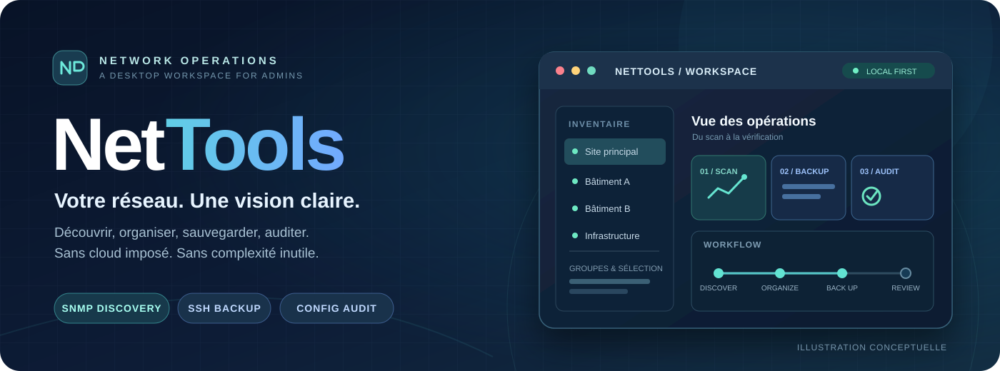
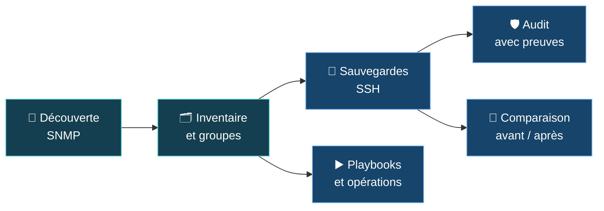

<div align="center">



<br />

**Un vrai poste de travail pour les admins réseau.**  
Découverte SNMP · Inventaire multi-sites · Backups SSH · Audit de configurations · Playbooks

<br />

[](https://github.com/neosoda/NetTools/releases/latest)
[](https://github.com/neosoda/NetTools/actions/workflows/ci.yml)
[](LICENSE)
[](#installation)

<br />

### [⬇️ Télécharger NetTools](https://github.com/neosoda/NetTools/releases/latest) · [📘 Guide utilisateur](NOTICE.md) · [🛠️ Documentation](docs/README.md) · [✨ Nouveautés](RELEASE_NOTES_v1.7.0.md)

<sub>Application desktop open source · Go + Wails + React · Données locales · Aucun compte cloud requis</sub>

</div>

---

## ✨ Pourquoi NetTools ?

**Moins d'onglets, moins de scripts dispersés, plus de visibilité sur vos équipements.**

NetTools réunit les opérations quotidiennes d'administration réseau dans une interface Windows : découvrir des équipements, les classer, sauvegarder leurs configurations, détecter des écarts et exécuter des opérations contrôlées.

- **Local-first** — inventaire SQLite, paramètres et historiques conservés sur votre PC ; pas de service cloud obligatoire.
- **Pensé pour les parcs réels** — plusieurs sites, plusieurs constructeurs, des groupes d'équipements et des opérations par lots.
- **Des résultats vérifiables** — états de sauvegarde, empreintes SHA-256, preuves d'audit et comparaison avant/après intervention.
- **Un outil d'administration, pas une boîte noire** — vous gardez le contrôle des commandes et des cibles.

## 🧰 Tout l'essentiel, au même endroit

| | Module | Ce que vous pouvez faire |
|:---:|---|---|
| 🔎 | **Découverte SNMP** | Scanner des réseaux CIDR, plages ou listes IPv4 (TXT/CSV) avec SNMP v1/v2c/v3 ; exporter les résultats vers Excel. Jusqu'à **1 024 cibles par scan**. |
| 🗂️ | **Inventaire & groupes** | Ajouter, importer et retrouver les équipements ; fusionner par IP ; organiser le parc par site, bâtiment ou groupe personnalisé, puis sélectionner en masse. |
| 💾 | **Sauvegardes SSH** | Collecter les configurations de plusieurs constructeurs ; consulter l'historique, la qualité des captures, les empreintes SHA-256 et exporter en ZIP. |
| 🔀 | **Comparateur** | Comparer deux configurations ou deux sauvegardes, côte à côte ou en vue unifiée ; filtrer le bruit et exporter en HTML. |
| 🛡️ | **Audit de configurations** | Exécuter des contrôles génériques ou par constructeur ; obtenir les **preuves**, statuts et recommandations sans remédiation automatique. |
| ▶️ | **Playbooks YAML** | Exécuter des séquences SSH, suivre les commandes et résultats en direct et demander l'arrêt d'une opération. |
| 🗓️ | **Planificateur** | Planifier scans, sauvegardes, audits, playbooks et commandes SSH avec une programmation adaptée. |
| 📋 | **Journaux & paramètres** | Gérer les profils d'accès, le dossier des sauvegardes, les journaux, leur rétention et les préférences. |

<sub>Les modules Topologie et suivi des ports ont été retirés en v1.6.0. NetTools ne prétend pas certifier la conformité d'un réseau.</sub>

## ⚡ De la découverte à l'audit



**Cas d'usage :** avant une maintenance, réalisez une sauvegarde ; après l'intervention, récupérez la nouvelle configuration et comparez les deux états. Pour une revue de sécurité, partez d'une sauvegarde exploitable et examinez chaque preuve d'audit.

### 🆕 Ce qu'apporte la v1.7.0

| Nouveauté | En pratique |
|---|---|
| **Playbooks en temps réel** | Progression, équipement et commande en cours, terminal live, détail des réussites et des échecs. |
| **Inventaire par groupes** | Arborescence par site ou bâtiment, sélection globale ou partielle et affectations en lot, y compris depuis Backups, Audits et Playbooks. |
| **Boutons d'arrêt** | Demande d'annulation des scans, sauvegardes et playbooks, avec conservation des résultats déjà collectés. |

[Lire les notes de version complètes →](RELEASE_NOTES_v1.7.0.md) · [Voir toutes les versions →](https://github.com/neosoda/NetTools/releases)

## 🚀 Installation

**Prérequis :** Windows **10/11 64 bits** avec [Microsoft Edge WebView2 Runtime](https://developer.microsoft.com/en-us/microsoft-edge/webview2/) (généralement déjà installé).

1. Ouvrez la page [**Dernière version de NetTools**](https://github.com/neosoda/NetTools/releases/latest).
2. Téléchargez `NetTools.exe` et le fichier `.sha256` correspondant.
3. Vérifiez l'empreinte depuis PowerShell :

   ```powershell
   Get-FileHash .\NetTools.exe -Algorithm SHA256
   Get-Content .\NetTools.exe.sha256
   ```

4. Lancez `NetTools.exe`, configurez vos profils **SSH/SNMP** dans **Paramètres**, puis commencez avec **Découverte**.

> **À savoir :** une empreinte correspondante confirme la cohérence avec le fichier de contrôle téléchargé, pas l'authenticité indépendante du binaire. Téléchargez depuis les releases officielles.

### 📂 Où sont stockées les données ?

| Données | Emplacement par défaut |
|---|---|
| Inventaire SQLite et préférences | `%APPDATA%\NetTools\` |
| Journaux | `%APPDATA%\NetTools\logs\` |
| Sauvegardes réseau | `%USERPROFILE%\Downloads\NetTools_Backups\` |

Les sauvegardes peuvent être dirigées vers un autre dossier. L'inventaire est **persistant par défaut** ; un mode éphémère est disponible dans les paramètres.

## 🌐 Constructeurs et protocoles

**Découverte :** SNMP v1, v2c et v3 USM. **Collecte :** SSH, avec des chemins adaptés notamment à :

| Cisco | Aruba / HP | HPE | Huawei | Fortinet | Allied Telesis |
|:---:|:---:|:---:|:---:|:---:|:---:|
| IOS / IOS XE | AOS-S / ProCurve | Comware | VRP | FortiOS | AlliedWare Plus |

La compatibilité exacte dépend du modèle, du firmware, des droits SSH et du comportement de l'équipement. **Validez d'abord sur un équipement de test.**

## 🧑‍💻 Pour les développeurs

NetTools utilise **Go 1.26**, **Wails v2**, **React 19**, **TypeScript**, **Vite** et **SQLite**.

<details>
<summary><strong>Afficher les prérequis et commandes de développement</strong></summary>

<br />

**Environnement :** Go avec toolchain `1.26.10`, Node.js `22.22+` (CI sous Node 24), Wails CLI `2.17.0`. Le développement desktop et le packaging visent Windows.

```bash
git clone https://github.com/neosoda/NetTools.git
cd NetTools

go mod download
go install github.com/wailsapp/wails/v2/cmd/wails@v2.17.0
npm ci --prefix frontend --legacy-peer-deps

npm run dev
```

Pour les validations :

```bash
npm run check
```

Pour compiler l'application sous Windows :

```bash
npm run build
```

L'exécutable est généré dans `build/bin/NetTools.exe`. Pensez à ajouter `$(go env GOPATH)/bin` (ou son équivalent Windows) au `PATH` pour utiliser `wails`.

Le frontend et le backend disposent de contrôles automatisés ; leur existence ne remplace pas les essais sur de vrais équipements autorisés.

</details>

**Explorer le code :** [Frontend React](frontend/src) · [Backend Go](internal) · [Architecture](docs/ARCHITECTURE.md) · [Guide de développement](docs/DEVELOPMENT.md)

## 🔐 Sécurité et limites importantes

NetTools manipule des informations d'infrastructure sensibles.

- Sous Windows, **les identifiants sont protégés par DPAPI**, mais les sauvegardes, exports, logs et la base locale ne sont **pas automatiquement chiffrés dans leur ensemble**.
- **Les clés d'hôte SSH ne sont pas encore vérifiées**. Tenez compte de cette limite avant tout usage dans un environnement non fiable.
- Les **playbooks peuvent modifier les équipements** : validez leurs commandes et n'intervenez que sur des réseaux autorisés.
- Les audits ne concluent pas sur une sauvegarde absente ou inexploitable ; les recommandations restent **consultatives** et n'exécutent **aucune remédiation**.
- Les tâches planifiées s'exécutent **pendant que l'application est ouverte** ; NetTools n'est pas un service Windows permanent.

Consultez [**SECURITY.md**](SECURITY.md) pour les vulnérabilités, le signalement confidentiel et les limites détaillées.

## 🤝 Contribuer et obtenir de l'aide

Une idée, un bug ou une amélioration ? Les contributions sont bienvenues, notamment sur la compatibilité constructeur, l'ergonomie, les traductions et la documentation.

[**Ouvrir une issue**](https://github.com/neosoda/NetTools/issues/new/choose) · [**Proposer une pull request**](https://github.com/neosoda/NetTools/pulls) · [**Guide de contribution**](CONTRIBUTING.md) · [**Support**](SUPPORT.md)

N'incluez **jamais** de secrets, d'adresses internes sensibles ni de configurations réelles dans une issue ou une PR publique.

## 📚 Documentation

| Ressource | Contenu |
|---|---|
| [📘 Guide utilisateur](NOTICE.md) | Utilisation de chaque module, paramètres et dépannage |
| [🛠️ Documentation technique](docs/README.md) | Guides de développement et références |
| [🏗️ Architecture](docs/ARCHITECTURE.md) | Frontend, backend, données et responsabilités |
| [📋 Historique](CHANGELOG.md) | Évolutions du projet |
| [🛡️ Politique de sécurité](SECURITY.md) | Signalement et limites connues |

---

<div align="center">

**Built for network admins who like to stay in control.** ⚡

<sub>Créé et maintenu par <a href="https://github.com/neosoda">neosoda</a> · Code original sous <a href="LICENSE">Apache License 2.0</a> · <a href="NOTICE">Attributions</a> · <a href="THIRD_PARTY_NOTICES.md">Licences tierces</a></sub>

<br /><br />

<a href="https://github.com/neosoda/NetTools#readme">Retour en haut ↑</a>

</div>
