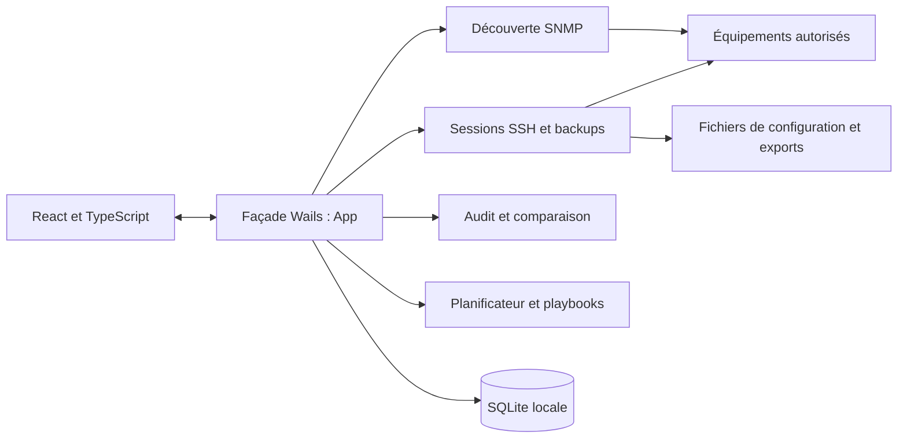

# Architecture NetTools

## Du bureau aux équipements

`main.go` assemble la fenêtre Wails et les assets embarqués. `app.go` expose
les méthodes utilisées par React, initialise les services, orchestre les tâches
et transmet des événements de progression. Le frontend n'est pas une application
web complète utilisable avec le seul serveur Vite : ses opérations métier
requièrent les bindings et le runtime Wails.

## Responsabilités

| Répertoire | Responsabilité |
| --- | --- |
| `internal/db` | Initialisation SQLite/GORM, modèles, migrations et catalogue de règles. |
| `internal/snmp` | Validation des cibles, scanner, sécurité SNMPv3, collecte et identification. |
| `internal/ssh` | Connexions, commandes, sessions interactives, prompts, pagination et diagnostics. |
| `internal/backup` | Collecte et qualité des configurations, fichiers, historique et export ZIP. |
| `internal/audit` | Évaluation des contrôles, applicabilité, preuves et statuts. |
| `internal/diff` | Comparaison de configurations. |
| `internal/playbook` | Séquences de commandes et exécuteur Python/Netmiko facultatif. |
| `internal/scheduler` | Validation et déclenchement des tâches cron pendant la session applicative. |
| `internal/secret` | DPAPI Windows et fallback AES hors Windows. |
| `internal/logger` | Journaux fichiers et événements. |
| `frontend/src` | Pages React, composants, contextes et wrappers des appels backend. |
| `frontend/wailsjs` | Contrats et runtime générés : ne pas modifier à la main. |

La présence de dépendances de visualisation dans le lockfile ne signifie pas
qu'un écran est proposé : Topologie et Port Tracker ne font plus partie de
la navigation publique depuis v1.6.0.

## Données et cycle de vie

Au démarrage, l'application ouvre ses données sous `%APPDATA%\NetTools` sur
Windows, initialise les services et démarre le planificateur. SQLite conserve
l'inventaire par défaut. L'option `ephemeral_inventory` demande explicitement
la suppression des équipements au prochain démarrage ; cette option ne doit
pas être confondue avec une suppression des fichiers de sauvegarde.

Les backups sont stockés séparément de leurs métadonnées SQLite, par défaut
dans le dossier de téléchargements de l'utilisateur. Préservez la cohérence
entre la base et les fichiers lors d'une migration ou d'une restauration.
Le planificateur a besoin d'une application ouverte : ses données persistent,
mais son processus n'est pas un service Windows indépendant.

## Garanties à préserver dans les contributions

- Conserver les formats de données et chemins utilisateur, sauf migration explicite.
- Respecter validation des cibles, timeouts, annulation et limites de concurrence.
- Préserver les contrôles de capture, hash et intégrité ZIP des backups.
- Ne pas transformer une absence de preuve en conformité automatique.
- Garder les recommandations d'audit consultatives ; les playbooks sont un flux distinct.
- Ne pas exposer de secret dans les réponses, événements, logs ou diagnostics.
- Ne pas importer des règles ou fixtures propres à une infrastructure privée.

Les limites SSH, chiffrement et distribution sont décrites dans
[SECURITY.md](../SECURITY.md), les pratiques de travail dans
[CONTRIBUTING.md](../CONTRIBUTING.md), et les vérifications de migration dans
[OPEN_SOURCE_AUDIT.md](OPEN_SOURCE_AUDIT.md).
