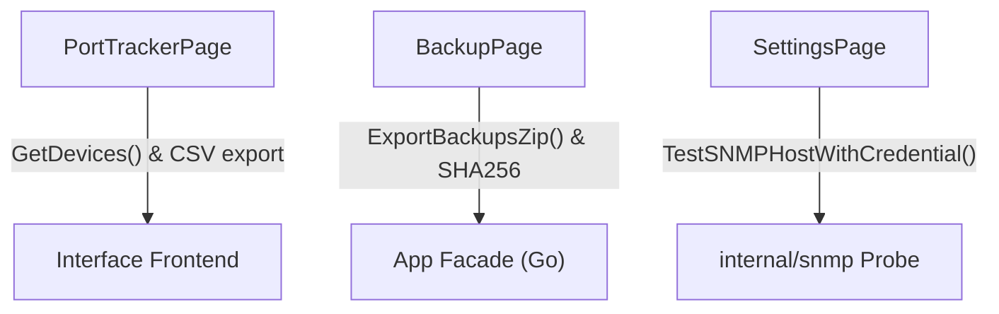

# TRD

- Spec ID: nettools-v1-5-improvements
- Status: draft
- Owner: unassigned
- Last reviewed: pending

## Context

Amélioration des fonctionnalités d'administration réseau sur NetTools v1.5.0 sous architecture Wails v2 / Go / React.

## Proposed architecture

## Interfaces and dependencies

- Frontend: Utilisation des méthodes Wails existantes (`GetDevices`, `ExportBackupsZip`, `TestSNMPHostWithCredential`).
- Backend: `internal/snmp`, `internal/backup/manager.go`, `internal/porttracker`.

## Security, performance, observability

- Confidentialité: Aucun secret SNMPv3 n'est exposé côté frontend; le test s'exécute côté backend avec les clés déchiffrées en mémoire locale.
- Intégrité: Vérification systématique du hash SHA256 des fichiers avant packaging ZIP.
